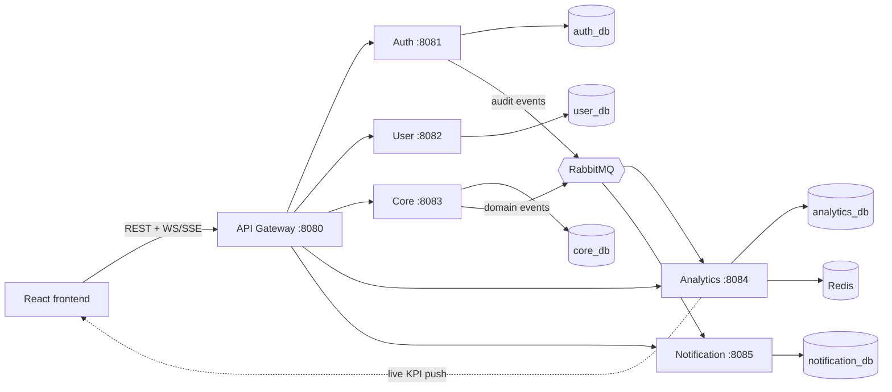

# Architecture

## Rules

- **REST** when the caller needs an answer now. **Events** for analytics, notifications, audit side-effects. **WS/SSE** only for server -> browser push.
- Each service owns its database. No cross-service table access.
- Auth owns password hashes and refresh tokens. Nobody else reads them.
- Analytics never writes to core data; it builds read-optimised aggregates from events.
- Gateway validates the JWT and adds `X-Correlation-Id`. Services **still** verify the JWT and enforce permissions (defence in depth; frontend hiding is never security).

## Decisions to record (add an ADR in `docs/adr/` when you decide)

- JWT signing: HS256 shared secret (simple) vs RS256 (auth holds private key, others verify with public key).
- Real-time channel: SSE vs WebSocket.
- Refresh token delivery: HttpOnly cookie (recommended).
